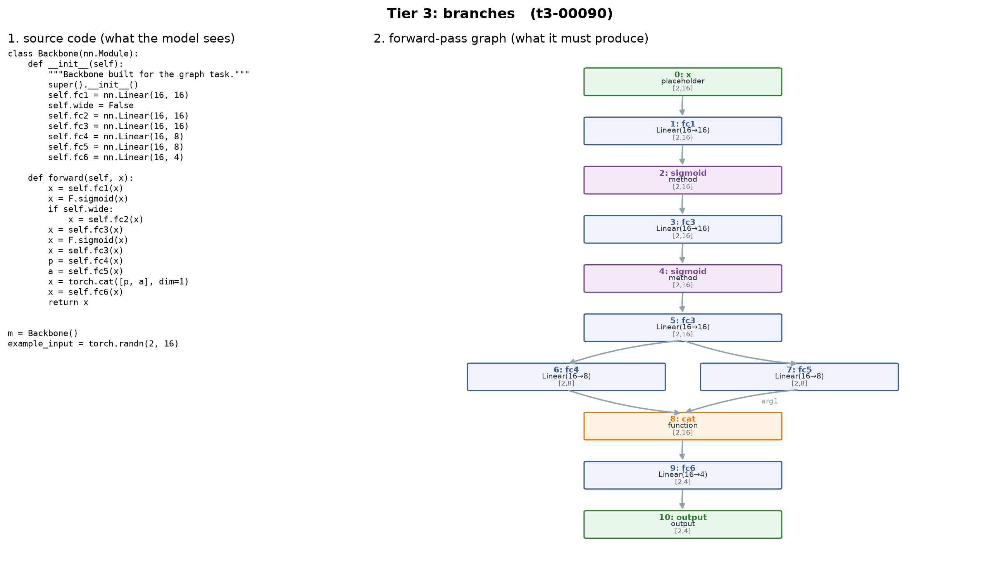

# graphArt_LM

**Can a large model read neural-network code and draw its forward pass as a graph, without running it?**



> **Domain correction (Oct 2026).** This project briefly used Qiskit quantum-circuit DAGs,
> on the reasoning that `circuit_to_dag` supplies exact ground truth for free. The TA
> corrected that after the prep presentation: the allotted statement asks for a *deep
> neural network forward pass* traced from `forward()` and the module class, and
> substituting Qiskit code was not an acceptable reading. PyTorch is the domain. The
> circuit work is retired but intact under `graphart/legacy_qiskit/`, and the harness can
> still score it by repointing `graphart/domain.py` — which is the evidence that the
> framework is genuinely domain-agnostic.

## Where it stands (23 Nov 2026)

Graphs right on real `torchvision` code, **exact / lenient** (lenient: the same computation
written differently — layer settings left out, `F.relu` for `nn.ReLU`, `a + b` for `b + a`):

| | Flat format: dev, 21 blocks | Flat format: unseen, 17 blocks (frozen) | Hierarchical: dev blocks, 21 | Hierarchical: dev networks, 30 |
|---|---|---|---|---|
| 1.5B, fine-tuned | 6 / 11 | 0 / 0 | 9 / 9 | 0 / 0 |
| 14B, prompted | 1 / 4 | not run | 0 / 1 | 0 / 2 |
| 1.5B + 14B, joined | 8 / 13 | not run | 9 / 10 | 0 / 2 |

On our generator's own test programs the fine-tuned adapters are 40/40.

- **Prompted, size decides it.** Right topology on generated code: 1.5B 5%, 7B 25%, 14B 60%,
  Gemma 31B 93%.
- **Fine-tuning learns the generator.** The tuned 1.5B is 40/40 on generated code and 0/21 on
  torchvision, where it draws chains.
- **Real-looking training code, then splitting the task.** Library-style training programs
  took torchvision from 0 to 7/21. The best node lister names the right nodes on 15/21; a tuned
  1.5B wirer wires the true nodes right on 16/21; joined, 11/21 (13/21 with the 14B as wirer).
- **Naming the variable on each edge makes the answer follow the code.** On 69 edits that
  change the graph, the two-step model answers with the unedited graph 14 times, the one-step
  model 39 times (exact McNemar p ≈ 4e-7).
- **The frozen holdout: 0/17 for every system.** 13 of the 17 import torchvision layers whose
  code is not in the prompt; others hinge on configuration flags.
- **Hierarchical format (module tree + one wiring graph per class):** 0/30 whole networks;
  10/30 when the true tree is given. Writing the tree means working out the constructor's
  loop counts and computed widths.

Every variant, criterion and number since 26 Oct: [docs/experiments.md](docs/experiments.md).
Write-ups: `report/novelty/` (novelty report), `report/poster/` (poster). Demo: [Interface](#interface).

---

## What we are making

**Input:** Python source defining an `nn.Module`.
**Output:** its forward-pass graph, written as text in a fixed format.

```python
class Net(nn.Module):
    def __init__(self):
        super().__init__()
        self.fc1 = nn.Linear(8, 16)
        self.fc2 = nn.Linear(16, 8)
        self.out = nn.Linear(8, 2)

    def forward(self, x):
        h = torch.relu(self.fc1(x))
        h = self.fc2(h) + x          # residual
        return self.out(torch.relu(h))

model = Net()
example_input = torch.randn(1, 8)
```

```
INPUTS 1
NODES
0 placeholder x [1,8]
1 call_module fc1 Linear(in=8,out=16,bias=True) [1,16]
2 call_function relu [1,16]
3 call_module fc2 Linear(in=16,out=8,bias=True) [1,8]
4 call_function add [1,8]
5 call_function relu [1,8]
6 call_module out Linear(in=8,out=2,bias=True) [1,2]
7 output output [1,2]
EDGES
0 -> 1 : arg0
1 -> 2 : arg0
2 -> 3 : arg0
3 -> 4 : arg0
0 -> 4 : arg1          <- the residual: the input feeds the add's second slot
4 -> 5 : arg0
5 -> 6 : arg0
6 -> 7 : arg0
```

Each node is one traced operation. An edge `A -> B` means A's output is an argument of B,
and it names **which argument slots** it fills — because `a - b` and `cat([a, b])` are
order sensitive. If one value fills several slots of the same operation, that is one edge
listing them all (`4 -> 5 : arg0 arg1`).

`torch.fx.symbolic_trace` is PyTorch's own representation of the forward pass, so the
ground truth is exact and free, with nothing labelled by hand.

### Why this is harder than it looks

1. **The code hides the graph.** Loops must be unrolled, `nn.Sequential` and `ModuleList`
   expanded one node per layer, and branches that cannot run dropped entirely.
2. **A layer list is not a graph.** A residual connection runs from an early node to a
   much later one; no ordering of the operations recovers it. The model has to track
   which node each live variable currently refers to.
3. **The output must be exactly right.** One missed layer or edge and the graph is wrong.
   `graphart/validate.py` catches malformed answers without reference to the truth.

---

## Project roadmap

Cheapest to most involved. Every phase is scored by the same harness, so results compare.

### Phase 0: Dataset and evaluation harness ✅ done
Generator for code → graph pairs in 4 tiers, ground truth from `torch.fx`, a structural
validator, metrics, and a renderer.

### Phase 1: Prompting baselines ✅ done
Six prompts (see [Prompts](#prompts)), four backends, per-sample reply caching, and a
cost gate that refuses to spend without an explicit `--yes`. Four model sizes zero-shot,
and all six prompts on Qwen 14B on a free Kaggle GPU (`notebooks/kaggle_ollama.ipynb`);
see [Results](#results-so-far).

### Phase 2: LoRA fine-tuning a small open model ✅ done: 40/40 exact on our generator's code — but see the closing experiments
LoRA on `Qwen2.5-Coder-1.5B-Instruct` with the 1280 training samples, on a free Kaggle GPU
(`notebooks/kaggle_finetune.ipynb`, built by `scripts/make_kaggle_notebook.py --finetune`).
Each example is the `zero_shot` prompt plus the reference graph as the answer; the val split
picks the checkpoint. The tuned adapter and its untuned base are scored through the same
runner (`--backend hf`) on the same 40 test samples as Phase 1. Locally:
`pip install -r requirements-finetune.txt`, then `scripts/train_lora.py`.

### Phase 3 (stretch): a tiny transformer from scratch
nanoGPT-scale, to ask whether general pretraining is necessary at all.

### Phase 4: Generalisation ✅ done (RQ4–RQ6)
Real architectures from `torchvision`, controlled edits, and a held-out code construct;
see [Closing experiments](#closing-experiments-rq4rq6-fine-tuned-15b-vs-prompted-14b).

### Phase 5: Interface ✅ done (five pages since 22 Nov)
Paste code, see the predicted graph beside the reference with differences highlighted, in
both formats, from saved runs or live; see [Interface](#interface).

### Phase 6: Real-looking training data, two steps, composition ✅ done (29 Oct – 15 Nov)
Library-style training programs (generator v2), a two-step format (nodes, then edges naming
the variable each reads), and composition: one model lists the nodes, another wires them
(E1–E4). See [After the closing runs](#after-the-closing-runs-real-looking-data-two-steps-composition).

### Phase 7: The frozen torchvision holdout ✅ scored once (15 Nov): 0 of 17
See [The frozen holdout](#the-frozen-holdout-0-of-17-for-every-system).

### Phase 8: The hierarchical format ⏳ in progress (from 19 Nov)
A module tree plus one wiring graph per class `forward()`, so whole networks fit in an answer.
Dev result, the prompted 14B, lighter formats and per-instance trees; the locked test sets
are not scored yet. See [Hierarchical format](#hierarchical-format-module-tree--one-wiring-graph-per-class).

### Research questions
1. How does accuracy fall as the code hides more of the structure (tier 1 → 4)? And as
   the graph grows?
2. Is the hard part *reading the code* or *building the graph*? (The `nodes_only` /
   `edges_only` pair answers this.)
3. Prompting vs fine-tuning vs from scratch: best accuracy for the compute spent?
4. Do models learn the rule, or memorise the generator's habits? (Real `torchvision` code
   is the test.)
5. Does a model track dataflow, or match patterns? Controlled edits that keep the graph
   should not change its answer; edits that change the graph should change it correctly.
6. Can a fine-tuned model handle a construct it never saw in training?

Questions 4–6 came out of the Phase 2 result; [docs/research_story.md](docs/research_story.md)
tells how, and records what each experiment found.

---

## Dataset

### Synthetic generator (`graphart/generate.py`)

The tiers vary **how much the code hides the forward pass**, not how big the network is.

| Tier | What the code looks like | Samples | Nodes min/avg/max | Merges |
|---|---|---|---|---|
| 1 flat | one layer per line; reading it is transcription | 400 | 7 / 10.1 / 14 | 0.00 |
| 2 loops | `Sequential`, `ModuleList`, blocks built in a loop | 400 | 8 / 10.4 / 13 | 0.00 |
| 3 branches | residuals, concat splits, dead branches, a reused layer | 400 | 8 / 12.0 / 16 | **2.02** |
| 4 blocks | residual CNN, inception, transformer, U-net | 400 | 12 / 15.1 / 25 | 1.88 |

Tiers 1 and 2 are deliberately pure chains — the difficulty is in reading the code. Tier 3
is where topology appears, and it **manufactures** branching on purpose: measured across
`torchvision`, real architectures sit at an edge-to-node ratio of about 1.1, so found code
does not supply the topology the project is about.

Splits are 80/10/10 within each tier: **1280 train / 160 val / 160 test**. Samples are
deduplicated by graph, so no graph appears in two splits.

### Against house style

A generator that always writes `self.conv1`, always imports the same way and always names
its class `Net` teaches a model its habits rather than the task — and the model then scores
well on a test split that shares those habits and collapses on real code, without us
noticing.

So *what the network is* and *how the code is written* are separated. Tier functions choose
layers and connections; `Style` independently chooses the import form, class name, model
variable, attribute naming scheme, activation idiom, forward-variable convention,
docstrings, comments and bias. Over 320 programs: 14 class names, 5 model variables, 4
import blocks, roughly half functional and half module activations.

### Real code

`torchvision` is the held-out generalisation set. All 15 architectures tested trace
cleanly. The smallest with genuine branching are `squeezenet1_1` (68 nodes, 8 merges) and
`resnet18` (71, 8); `vgg11` and `alexnet` are pure chains and useless as topology tests.
That measurement is what sets the 80-node cap in the dataset builder.

### Library-style set (`graphart/generate_large.py`)

The closing experiments showed the tuned model learned the first generator's shortcuts
(one class per program, the input always `x`, every flag `False`, a fixed menu of layers),
so a second generator writes programs the way torchvision does. Tier 5 is one building
block; tier 6 is a whole small network built from it, in seven families: ResNet basic and
bottleneck, Inception, inverted residual (with optional squeeze-excitation), SqueezeNet
Fire, DenseNet, ShuffleNet and a ViT-style encoder. The code has helper classes and helper
functions, `_make_layer`-style stages (paths like `stage1.0.shortcut.0`), `Optional`
sub-modules checked with `is not None`, flags that are `True` as often as `False`,
depthwise and grouped convolutions, kernels like `(1, 7)`, `F.` functions, tensor methods,
and inputs named `input`, `feats`, `z` as well as `x`.

| Tier | Programs | Nodes min / mean / max | Merges / graph | Answer tokens (max) |
|---|---|---|---|---|
| 5 block | 400 | 8 / 17.4 / 38 | 1.85 | ~1,600 |
| 6 network | 400 | 25 / 64.1 / 120 | 6.53 | ~6,900 |

`scripts/build_large_dataset.py --per-tier 400` writes `data/generated/large_{train,val,test}.jsonl`
(640 / 80 / 80), so every tool reads it by split name: `run_prompting --split large_test`,
`score`, `classify_errors`, and `train_lora.py --train-split train,large_train --val-split
val,large_val --max-len 8192`. Duplicates are removed by graph isomorphism (the first builder
compared text, which let 4 isomorphic duplicates through), and any program
topology-isomorphic to one of the 21 torchvision samples is rejected, so torchvision stays an
out-of-distribution test.

**Generator v2** (31 Oct) added the torchvision idioms behind the first library-style run's
misses. Generator rounds stopped there: patching the generator on the 21 samples' errors was
fitting them, so from then on the 21 are **development data**.

### The torchvision holdout (frozen)

`data/generated/torchvision_holdout.jsonl`: 17 blocks and small networks from 10 torchvision
families the 21 never use, frozen by sha256 in `data/generated/FROZEN.json` before any model
saw them, and scored **once** (15 Nov) on the setup fixed in that file's dated amendment. It
is spent: nothing is tuned, re-prompted or re-run on it.

### Hierarchical data (generator v3, timm)

For the hierarchical format the answers describe whole networks, so the data does too
(`scripts/build_hier_dataset.py`, `scripts/build_hier_eval.py`; every truth is checked to
expand back into the fx graph exactly).

| Set | What it is | Programs | fx nodes per network, median (range) |
|---|---|---|---|
| `hier_train` / `hier_val` | generator v3 (`graphart/generate_v3.py`, 70% whole networks) + real `timm` models + tiers 1–4 | 1,810 training | 131 (22–2,684) |
| `hier_dev` | the 21 torchvision blocks + 30 whole torchvision networks | 51 | 177 (24–548) |
| `hier_gen_test` | held-out generator v3 programs: 24 blocks + 51 networks | 75 | 109 (29–352) |
| `hier_holdout`, `hier_timm_test` | locked: unseen torchvision families, and 3 timm families | 15 + 6 | up to 1,902 |
| `hier_inst_train` / `hier_inst_val` | per-instance trees (`scripts/build_hier_inst.py`): one example per class instance | 12,304 / 666 | — |

The locked sets are frozen in `data/generated/FROZEN_v2.json`, scored once after a dated
amendment declares the pipeline; their families are excluded from training.
`graphart/reduce.py` strips docstrings, comments, annotations and unused methods from the
code before a model reads it, without changing what it builds.

---

## Evaluation (`graphart/validate.py`, `graphart/metrics.py`)

| Metric | Meaning |
|---|---|
| **valid** | Well formed, judged without reference to the answer: acyclic, one output, every node reachable from an input or parameter, operation arities respected, module paths a valid tree, declared shapes mutually consistent |
| **valid_topology** | The same, ignoring shape consistency. This is what gates `exact` |
| **exact** | The same graph as the reference, by labelled isomorphism. The headline number |
| **topo** | `exact`, but comparing nodes without their module parameters and without the function-vs-method distinction (`x.tanh()` vs `torch.tanh(x)`). A model that puts the right operation in the right place but spells it in another notation has still recovered the topology |
| **right graph** | `topo`, but also forgiving an activation written as a function where the code has a layer (or the reverse), `F.max_pool2d` vs `max_pool2d`, and `a + b` vs `b + a`. Still requires every operation and every connection. Computed by `scripts/classify_errors.py`, added after the closing runs and applied to every run |
| **node F1 / edge F1** | Partial credit on the node and edge multisets |
| **reach F1** | Connectivity preservation: overlap of the (ancestor, descendant) pairs — every "B depends on A" relation through any path — compared on topology labels. Rerouting one edge keeps most of them; flattening a branching network into a chain invents many |
| **shape_acc** | Of the nodes whose label was right, how many also had the right shape |

Shapes are scored **separately on purpose**. Shape inference is a different skill from
topology, and if a shape were part of the node label then one miscomputed dimension would
drop an otherwise perfect graph to `exact = 0` and the topology result would be lost.

**Why a miss is a miss.** `scripts/classify_errors.py` puts every reply into one category
by graph-isomorphism tests tried in a fixed order: right graph (`exact`, `notation`,
`spelling`, `commutative`), narrow error (`arg_slots`, `coarse_*` — a block drawn as one box,
checked by re-tracing the real code with that block kept whole), or wrong (`gave_original`,
`miswired`, `wrong_ops`, `unparseable`). Per-reply categories go to `results/errors/`. The
headline scorer is unchanged; this only explains its misses.

See [docs/validator.md](docs/validator.md) for a plain-language account of what the
validator checks and what it got wrong at first.

**Comparisons.** Two runs on the same programs are compared by exact McNemar on the programs
only one gets right; single numbers carry Wilson 95% intervals. Criteria are written down
before a run (in `docs/experiments.md`).

### Scoring the hierarchical format (`graphart/hier_score.py`, `pipeline/score_hier.py`)

Each part is scored separately, so the first part that fails can be named:

| Part | Right when |
|---|---|
| parse | the reply reads as `TREE` + `GRAPH` sections |
| tree (no params) / tree | every module with its class and nesting, then also its layer parameters (order-free), numbered runs `0-2:` expanded |
| variants | block instances fall into the same variants as the truth, up to renaming |
| wiring | each class's wiring graph is isomorphic to the truth's |
| **hier_right** (headline since 22 Nov) | tree with parameters, variants and every wiring graph all right |
| flat exact | the answer expanded into the flat graph equals fx's (secondary) |

---

## Results so far

The same 40 stratified test samples (10 per tier) for every run. Replies are in
`results/*.jsonl`; `python -m pipeline.compare results/*.jsonl --markdown` regenerates the
headline table.

The sections run in order: prompting (Phase 1), fine-tuning (Phase 2), the closing
experiments on real code (RQ4–RQ6), then everything since: real-looking training data, two
steps and composition, the frozen holdout, and the hierarchical format. The full log of the
later work is [`docs/experiments.md`](docs/experiments.md).

### Zero-shot across model sizes

| model | where | n | parsed | valid | **exact** | topo | t1 | t2 | t3 | t4 |
|---|---|---|---|---|---|---|---|---|---|---|
| Gemma 4 31B (`google/gemma-4-31b-it:free`) | OpenRouter, free tier | 40 | 0.93 | 0.93 | **0.75** | **0.93** | 0.70 | 0.90 | 0.70 | 0.70 |
| Qwen2.5-Coder 14B (`qwen2.5-coder:14b`, Q4) | Ollama, Kaggle 2× T4 | 40 | 0.47 | 0.47 | **0.17** | **0.60** | 0.20 | 0.20 | 0.20 | 0.10 |
| Qwen2.5-Coder 7B (`qwen2.5-coder:7b`, Q4) | Ollama, Kaggle 2× T4 | 40 | 0.80 | 0.55 | **0.20** | **0.25** | 0.30 | 0.50 | 0.00 | 0.00 |
| Qwen2.5-Coder 1.5B (`qwen2.5-coder:1.5b`, Q4) | Ollama, laptop CPU | 40 | 0.62 | 0.42 | **0.00** | **0.05** | 0.00 | 0.00 | 0.00 | 0.00 |

Tier columns are `exact`. The same runs by `topo` per tier, with `few_shot` for the two
mid-size Qwens:

| model | prompt | t1 | t2 | t3 | t4 | **topo** |
|---|---|---|---|---|---|---|
| Qwen 1.5B | zero_shot | 0.20 | 0.00 | 0.00 | 0.00 | **0.05** |
| Qwen 7B | zero_shot | 0.50 | 0.50 | 0.00 | 0.00 | **0.25** |
| Qwen 7B | few_shot | 0.90 | 0.70 | 0.10 | 0.00 | **0.42** |
| Qwen 14B | zero_shot | 1.00 | 0.80 | 0.20 | 0.40 | **0.60** |
| Qwen 14B | few_shot | 1.00 | 0.90 | 0.30 | 0.60 | **0.70** |
| Gemma 31B | zero_shot | 1.00 | 1.00 | 1.00 | 0.70 | **0.93** |

**What it shows so far**
- **Topology appears with scale, chains first (RQ1).** Within one family, zero-shot `topo`
  climbs 0.05 → 0.25 → 0.60 from 1.5B to 7B to 14B. The 7B handles half the pure chains
  (tiers 1–2) but none of tiers 3–4; branching first shows at 14B and is solved by Gemma
  31B. A typical 7B tier-3 error is to turn the dead-branch flag `self.wide = False` into
  graph nodes.
- **Worked examples teach the format, not the topology.** `few_shot` lifts the 7B from 0.25
  to 0.42 and the 14B from 0.60 to 0.70, almost all of it on tiers 1–2; the 7B still gets
  1/20 on tiers 3–4.
- **Gemma 4 31B recovers the topology of everything up to tier 3.** Residuals, concat
  splits, dead branches and a reused layer are all correct (tier 3 `topo` 10/10).
- **Its `exact` misses on tiers 1–3 are all notation**: `x.tanh()` written as a function
  rather than a method. Strict `exact` counts it; `topo` does not.
- **Tier 4 fails on one construct**: `a, q = self.attn(h, h, h)`. torch.fx records the tuple
  unpacking as two `getitem` nodes, including the unused attention weights, and all three
  transformer samples left them out. Every residual CNN, inception and U-net sample was exact.
- **The 1.5B model cannot do the task.** No exact answers; 12 of the 40 replies run away
  (130+ nodes for a 10-node network) until the 1500-token cap cuts them off.

### Qwen2.5-Coder 14B, all six prompts (Kaggle, 2× T4, Q4)

`topo` by tier. It is the fair column here: strict `exact` is dominated by a formatting
slip (below) that hits the prompts very unevenly.

| prompt | t1 | t2 | t3 | t4 | **topo** | exact | parsed |
|---|---|---|---|---|---|---|---|
| `zero_shot` | 1.00 | 0.80 | 0.20 | 0.40 | **0.60** | 0.17 | 0.47 |
| `few_shot` | 1.00 | 0.90 | 0.30 | 0.60 | **0.70** | 0.47 | 0.90 |
| `cot` | 0.90 | 0.80 | 0.10 | 0.30 | **0.53** | 0.15 | 0.55 |
| `cos` | 1.00 | 0.30 | **0.70** | 0.70 | **0.68** | 0.30 | 0.62 |
| `nodes_only` | 1.00 | 0.80 | 0.40 | 0.60 | **0.70** | 0.17 | 0.47 |
| `edges_only` | 1.00 | 1.00 | 0.40 | 0.60 | **0.75** | 0.75 | 1.00 |

For `nodes_only`, `topo` means the node list matches; for `edges_only`, the wiring of the
given nodes matches.

**What it shows** (10 samples per tier, so read single-tier differences of one or two
samples as noise)
- **Decomposition (RQ2): no extra penalty for doing both at once.** Reading the code alone
  (`nodes_only` 0.70) and wiring given nodes alone (`edges_only` 0.75) each fail about a
  quarter of the time; together (`zero_shot` 0.60) is about what two independent ~0.7–0.75
  skills would give (≈0.53). Both skills break on **tier 3** (0.40 each), where dead
  branches and reused layers change the node list and residuals and concats change the
  wiring.
- **Generic step-by-step hurts.** `cot` (0.53) is below `zero_shot` (0.60).
- **Simulation helps where the topology is, and hurts on containers.** `cos` gets 7/10 on
  tier 3, where every other prompt gets 1–4/10, and beats its control `cot` overall (0.68
  vs 0.53). But it gets 3/10 on tier 2, where the others get 8–9/10: walking `forward()`
  statement by statement, the model either keeps a node for the `nn.Sequential` container
  as well as its layers (4 samples), or expands a ModuleList of Sequentials one level only
  (`block1.0` instead of `block1.0.0`, 3 samples). Overall it ties `few_shot` (0.70).
- **The `cos` row is the second run.** The first `cos.txt` lacked the "expand
  `nn.Sequential`" rule the other prompts carry and said "one line per source statement";
  restoring the rule and saying "one line per layer" did not move tier 2 (still 0.30) and
  cost two tier-3 samples (0.90 → 0.70, both operand-slot errors in an `add`). The first
  run is kept in `results/archive/cos-without-sequential-rule/`. Further prompt edits
  should be tuned on the **val** split, not on these 40 test samples.
- **The 14B misreads the format line.** The prompts write a node as
  `<id> <op> <target> [<Class>(<params>)] [<shape>]`, brackets meaning "optional"; in 18/40
  `zero_shot` replies the model wrote a literal `Sigmoid [] [1,16]`. Prompts with worked
  examples (`few_shot`, `cos`) nearly never do. `topo` tolerates it; `exact` does not.

**Two fixes the first reply forced, before anything was counted.** The prompts named the
parameter format for Linear and Conv2d only, so a correct graph failed to parse on
`BatchNorm2d(8)`; all prompts now carry a full label table. And `topo` was added so a
notation slip cannot hide a correct topology. The one pre-fix reply is kept in
`results/archive/pre-label-table/`.

### Phase 2: LoRA fine-tuning Qwen2.5-Coder 1.5B (Kaggle, one T4)

LoRA (r=16) on the 1280 train samples, 2 epochs, 160 steps, 97 minutes in fp16. Each example
is the `zero_shot` prompt with the reference graph as the answer. Val loss fell
0.0016 → 0.0003 → 0.00009 → 0.00009; the last checkpoint was best. Scored on the same 40
test samples with the same `zero_shot` prompt, through `--backend hf`.

| model | t1 | t2 | t3 | t4 | **exact** | topo | parsed |
|---|---|---|---|---|---|---|---|
| Qwen 1.5B, untuned (HF, fp16) | 0.00 | 0.00 | 0.00 | 0.00 | **0.00** | 0.05 | 0.75 |
| **Qwen 1.5B + LoRA** | 1.00 | 1.00 | 1.00 | 1.00 | **1.00** | **1.00** | 1.00 |
| Qwen 14B, `few_shot` (its best prompt) | 0.60 | 0.90 | 0.20 | 0.20 | 0.47 | 0.70 | 0.90 |
| Gemma 4 31B, zero-shot | 0.70 | 0.90 | 0.70 | 0.70 | 0.75 | 0.93 | 0.93 |

Tier columns are `exact`.

**What it shows**
- **A 1.5B model tuned for ~1.5 GPU-hours gets every one of the 40 exact**, including all of
  tier 4 and the transformer blocks that beat Gemma 31B. Its untuned base gets none, and
  scores the same through Hugging Face as it did through Ollama (topo 0.05 both ways).
- **It holds on programs it cannot have seen.** On 20 fresh programs from an unused seed,
  none isomorphic to any train, val or test graph, it is 20/20 exact
  ([research story](docs/research_story.md), section 6).
- **This is in-distribution — and the closing experiments show it matters.** The test
  programs come from the same generator as the training programs. On real code, edited code
  and a held-out construct, the tuned model turns out to have learned the generator's
  regularities more than the rule; see below.
- **A small leak was found and does not change the result.** The dataset builder
  deduplicated by graph *text*, so the same graph written with its nodes in another order
  slipped through: 4 of the 160 test graphs are isomorphic to a train graph, with different
  programs. One is in the scored 40 (`t4-00340`); without it the tuned model is 39/39.
  The splits were left as they are so every result stays comparable.

### Closing experiments: RQ4–RQ6 (fine-tuned 1.5B vs prompted 14B)

Both models zero-shot, scored by the unchanged scorer, with `right graph` beside `exact` and
`topo`. Full account in [docs/research_story.md](docs/research_story.md), section 6.

**RQ4 — real code.** 21 blocks and small networks from `torchvision`'s own source. Before the
tuned model's results were opened, the set was split by a mechanical rule into
*in-distribution* (5: none of the constructs our 1,280 training programs never contain —
its own block classes, grouped convolutions, tuple kernels, un-shortened `F.` functions, an
`assert`) and *unseen constructs* (16).

| torchvision, 21 | Qwen 14B | Qwen 1.5B + LoRA |
|---|---|---|
| parsed | 14 | 18 |
| exact / topo | 1 / 1 | 0 / 0 |
| **right graph** | **4** | **0** |
| node F1 / edge F1 | 0.31 / 0.20 | 0.36 / 0.17 |
| in-distribution (5), right graph | 4 | 0 |
| unseen constructs (16), right graph | 0 | 0 |
| readable replies drawn as one straight chain (4 of 21 truths are) | 2 of 14 | **16 of 18** |

On real code the tuned model lists the layers in order and chains them — branches, `cat`s
and skip connections disappear — though it never does so on our test programs (0 of 18).
*Disclosure:* the in-distribution rule missed two things training never varies either:
helper functions (`conv3x3`, `conv1x1`, in all three ResNet samples) and the input's name
(always `x` in training). The split was kept as fixed.

**RQ5 — controlled edits**, counting only programs each model solved before the edit
(14B: 24, LoRA: 40).

| | Qwen 14B | Qwen 1.5B + LoRA |
|---|---|---|
| neutral edits, right graph | 87% | 94% |
| meaningful edits, right graph | 22% | 25% |
| **meaningful edits answered with the unedited graph** | **64%** | **68%** |
| rerouted input followed | 0 / 14 | 0 / 27 |

Both models are robust to renaming and aliasing and both redraw the familiar graph when the
wiring changes (`scripts/classify_errors.py --solved`, `scripts/analyze_edits.py`).

**RQ6 — a held-out construct.** An adapter trained without any dead-branch program (1,112
examples, one epoch) against the full adapter, on 84 probe programs (`scripts/analyze_rq6.py`):

| adapter | control | dead branch | dead flag added | flag set to `True` | dead layer written in |
|---|---|---|---|---|---|
| full | 1.00 | 1.00 | 1.00 | **0.00** (0/4) | 0 of 58 |
| held out | 0.86 | **0.11** | 0.72 | 0.25 | 18 of 58 |

Without examples the model does not infer that a `False` flag means the branch never runs;
with them, it deletes whatever sits under `if self.flag:` even when the flag is `True` —
every one of the 168 flagged branches in training was `False`.

**What it shows.** Fine-tuning taught real reading *within the generator's family* (40/40,
20/20 fresh, untuned 4/40 even with spelling forgiven), but leaned on regularities the data
allowed. "A tuned 1.5B beats a prompted 31B" holds on our generator's code; as a reader of
code in general it is weaker than the prompted 14B. The edit signature is shared by the 14B,
so it is not caused by fine-tuning. Caveats: small groups (4 flag-`True`, 5 in-distribution),
one seed, and the held-out adapter trained one epoch against two.

### After the closing runs: real-looking data, two steps, composition

Fresh LoRAs on Qwen2.5-Coder 1.5B (rank 16, one seed each), right graphs (exact in brackets).
Details, training runs and caveats: [docs/experiments.md](docs/experiments.md).

| Run | Trained on | Test 40 | Torchvision 21 |
|---|---|---|---|
| Phase 2, one step | tiers 1–4 | 40 (40) | 0 (0) |
| mixed, one step | tiers 1–6, generator v1 | 40 (40) | 7 (4) |
| mixed-v2, one step | tiers 1–6, generator v2 | 40 (40) | 7 (5) |
| two step, brief prompts | tiers 1–4 every 2nd + 5–6 | 40 (35) | 7 (5) |
| two step, full prompts, 65% of an epoch | tiers 1–4 every 8th + 5–6 | 30 (24) | 9 (5) |
| two step, full prompts, full epoch (2 GPUs) | tiers 1–4 every 8th + 5–6 | 33 (26) | 7 (4) |
| **E1**: mixed-v2 lists, 14B (CoS prompt) wires | — | — | **13** |
| **E4, the frozen pipeline**: mixed-v2 lists, 1.5B wirer wires | step 2 only | 40 (40) | **11** |
| 1.5B wirer given the true nodes (diagnostic) | | | 16 |

- **Real-looking code moves real code, once.** Tiers 5–6 took torchvision from 0 to 7; after
  that, every change landed at 7–9 of 21, within run-to-run noise.
- **Listing and wiring fail separately** (`scripts/decompose.py`). mixed-v2 lists the right
  nodes on 15/21 but wires 8 of them wrongly: it connects a node to the one listed just before
  far more reliably than to anything else (edge recall 0.87 vs 0.58).
- **Composition loses nothing** (E1, E4): joined, a sample is right exactly when the lister's
  nodes are right and the wirer wires the true nodes right.
- **The wirers lean on listing order** (E3 and the E4 order check): given the true nodes in
  another valid order, the 14B keeps 4 of 11 successes and the 1.5B wirer 1 of 14.
- **E2, controlled edits:** on 69 edits that change the graph, two-step answers with the
  unedited graph 14 times, mixed-v2 39 times (26 vs 1 discordant, p ≈ 4e-7); neutral edits
  stay right (88%, 90%). Neither follows a flag that switches a branch on (0/4).
- The torchvision gain is partly fitted: generator v2 was patched on the 21's errors.

### The frozen holdout: 0 of 17 for every system

| Torchvision holdout (17) | Right graphs | Node lists right | Node F1 | Edge F1 |
|---|---|---|---|---|
| 26 Oct submission | 0 | 0 | 0.19 | 0.07 |
| mixed-v2 alone | 0 | 0 | 0.34 | 0.15 |
| frozen pipeline (mixed-v2 + wirer) | 0 | 0 | 0.34 | 0.16 |

Wilson 95% for 0/17 is 0–18%. mixed-v2 lists the right nodes for none of the 17, so the wirer
had nothing to wire. 13 of the 17 import torchvision layers (`Conv2dNormActivation`,
`SqueezeExcitation`, …) whose code is not in the prompt; others hinge on configuration
flags (a squeeze-excitation branch drawn though it is switched off), or on constructs never
trained on (3D convolutions, `interpolate`). The 0 → 11 on the 21 does not generalise.

### Hierarchical format: module tree + one wiring graph per class

Real networks are long in the flat format (median 177 fx nodes, up to 548), every repeated
block written out again. The hierarchical answer (`graphart/hier.py`) writes what is inside
what once, and how each class's `forward()` connects its parts once:

```
TREE
BasicBlock#1
  conv1: Conv2d(in=64,out=64,k=3,s=1,p=1)
  bn1: BatchNorm2d(features=64)
  relu: ReLU
  conv2: Conv2d(in=64,out=64,k=3,s=1,p=1)
  bn2: BatchNorm2d(features=64)

GRAPH BasicBlock#1
0 input x
1 conv1 <- 0
2 bn1 <- 1
3 relu <- 2
4 conv2 <- 3
5 bn2 <- 4
6 add() <- 5, 0
7 relu <- 6
8 output <- 7
```

Identical numbered children collapse (`0-2: Block#1`), a class not in the code is one box, and
code expands the answer back into the fx graph, so fx stays the answer key. The tuned 1.5B
writes the tree, then one wiring graph per class (`pipeline/run_hier.py`).

| hier_right | Tuned 1.5B, own tree | Tuned 1.5B, true tree given | Prompted 14B, own tree (strict / lenient) |
|---|---|---|---|
| dev blocks (21) | 9 | 16 | 0 / 1 |
| dev networks (30) | **0** | 10 | 0 / 2 |
| generated test blocks (24) | 21 | | |
| generated test networks (51) | 24 | | |

- **The tree is the bottleneck.** To write it the model must work out loop and repeat counts,
  computed widths (`width_per_group`, `_round_to_multiple_of`), conditions and calls into other
  builders. On dev networks 20% of the modules are missing and 37% of the layer settings wrong.
- **A bigger prompted model does not fix it** (P1): the 14B's network trees are right no more
  often, and as a wirer it is far behind the tuned 1.5B (wiring all right on 0 vs 26 of 51,
  strict; 13 vs 26 lenient).

**Asking for less.** The same replies of the tuned 1.5B, scored with less required
(descriptive: chosen after the results were seen, so any format adopted from it must be
declared in `FROZEN_v2.json` before the locked sets are scored):

| | S3 all | S2 no layer settings | S1 skeleton | S0 class graphs only |
|---|---|---|---|---|
| dev blocks (21) | 9 | 11 | 11 | 16 |
| dev networks (30) | 0 | 3 | 5 | 9 |
| generated test networks (51) | 24 | 28 | 30 | 35 |

**Per-instance trees** (P2, `graphart/hier_inst.py`): a 1.5B writes one module's children at a
time, given its class code and constructor arguments, and code joins the answers. Trained
(val loss 0.0196); its scoring notebook (`notebooks/kaggle_hier_inst_eval.ipynb`) has not run yet.

---

## Prompts

| Prompt | What it isolates |
|---|---|
| `zero_shot` | baseline |
| `few_shot` | in-context format learning, 3 worked examples |
| `cot` | generic step-by-step — the control for `cos` |
| `cos` | chain-of-simulation: walk `forward()` statement by statement, recording which node each live variable refers to |
| `nodes_only` | can it read the code and list the operations? |
| `edges_only` | given the operations, can it wire them? |
| `edges_only_cos` | wiring given the operations, simulating `forward()` (E1's 14B wirer) |
| `nodes_only_few_shot`, `nodes_only_stack[_few_shot]` | node listing with worked examples, and with each node's source-line stack |
| `two_step_nodes[_brief]`, `two_step_edges[_brief]` | the two-step format: nodes with their stacks, then edges naming the variable each reads; `_brief` sketches the format, the full ones spell out every rule |
| `hier_tree`, `hier_wire` | the hierarchical format: the module tree, then one class's wiring graph |
| `hier_inst` | per-instance trees: one module's children, given its class code and arguments |

`nodes_only` and `edges_only` split the task in two. If both halves score well but the
full task does not, the failure is doing them at once — stamina or context — rather than
either skill. All worked examples come from the **train** split only (`prompts/hier_shots2.json`
is chosen from the hierarchical train split by a fixed rule).

---

## Quickstart

```bash
python -m venv .venv
```
```bash
.venv/Scripts/pip install -r requirements.txt
```
```bash
.venv/Scripts/python scripts/build_dataset.py --per-tier 400
```
```bash
.venv/Scripts/python scripts/make_figures.py
```
(On macOS/Linux, use `.venv/bin/` instead of `.venv/Scripts/`.)

### Phase 1: prompting

```bash
.venv/Scripts/pip install -r requirements-pipeline.txt
```

**Spending gate.** Any run that would cost money prints an estimate and refuses unless you
pass `--yes`. Free models, Ollama and the mock backend proceed on their own and still print
`$0.0000`. If a model's price cannot be looked up, the run is treated as paid and blocked.
`--cached-only` rebuilds results from replies already on disk, never constructs a backend,
and so cannot cost anything.

See exactly what would be sent, and what it would cost, without sending anything:
```bash
.venv/Scripts/python -m pipeline.run_prompting --prompt cos --backend mock --dry-run
```

Find model ids and live prices (no key needed):
```bash
.venv/Scripts/python -m pipeline.list_models qwen coder
```

Run, score, and compare:
```bash
.venv/Scripts/python -m pipeline.run_prompting --prompt zero_shot --backend openrouter --model "qwen/qwen-2.5-coder-32b-instruct" --stratify 10 --yes
```
```bash
.venv/Scripts/python -m pipeline.score results/openrouter__qwen-qwen-2.5-coder-32b-instruct__zero_shot.jsonl --slides
```
```bash
.venv/Scripts/python -m pipeline.compare results/*.jsonl --markdown
```

`--stratify 10` takes ten samples per tier — the *same* ten for every model, which is what
makes runs comparable. Replies are cached under `results/raw/`, so a re-run only pays for
what is missing and re-scoring is always free.

**Backends.** `openrouter` needs `OPENROUTER_API_KEY` and reaches every open-weight model
plus GPT and Gemini. `anthropic` needs `ANTHROPIC_API_KEY` from an Anthropic Console
account with credits — a Claude Pro subscription does **not** include API access — and uses
the native SDK rather than a proxy. `ollama` runs locally and costs nothing, but the
reference machine has no discrete GPU, so anything above ~1.5B is impractical there; use a
free Colab GPU for mid-size models.

---

### Reproducing everything

Every number in the report and deck comes from `results/*.jsonl` (committed) through the
scripts below, so re-scoring never needs a GPU. The data in `data/generated/` is committed
too; the first three commands rebuild it from scratch.

| step | command | needs |
|---|---|---|
| synthetic data (seed 0) | `scripts/build_dataset.py --per-tier 400` | CPU |
| real-code set (RQ4) | `scripts/build_torchvision_set.py` | `torchvision` |
| edit set (RQ5), probe set (RQ6) | `scripts/build_edit_set.py`, then `scripts/build_rq6_probe.py` | CPU |
| prompting runs (Phase 1) | `python -m pipeline.run_prompting --prompt <p> --backend <b> --model <m> --stratify 10` | see backends; Kaggle notebook: `scripts/make_kaggle_notebook.py` |
| fine-tuning (Phase 2) | `scripts/make_kaggle_notebook.py --finetune` → run `notebooks/kaggle_finetune.ipynb` on a Kaggle T4; or locally `scripts/train_lora.py --out models/<name>` | GPU (~100 min on a T4) |
| closing runs (RQ4–RQ6) | `scripts/make_kaggle_notebook.py --closing-hf` and `--closing-ollama` → run on Kaggle; RQ6's held-out adapter is `train_lora.py --exclude-construct dead_branch` | GPU, ≤2.5 h each |
| score one run | `python -m pipeline.score results/<run>.jsonl` | CPU |
| compare runs | `python -m pipeline.compare results/*.jsonl --markdown` | CPU |
| classify every miss | `scripts/classify_errors.py results/<run>.jsonl [--solved results/<test run>.jsonl --by edit]` | CPU |
| edits, RQ6 analyses | `scripts/analyze_edits.py <edits run> <test run>`, `scripts/analyze_rq6.py <rq6 runs>` | CPU |
| report figures and tables | `scripts/make_report_figures.py`, then `pdflatex` + `bibtex` in `report/` | LaTeX |
| deck | `scripts/make_final_deck.py` (after the report figures) | python-pptx |
| library-style data (tiers 5–6) | `scripts/build_large_dataset.py --per-tier 400` | CPU |
| two-step data | `scripts/build_two_step.py` (traces checked by `scripts/check_cos_trace.py`) | CPU |
| Phase 6 training | `make_kaggle_notebook.py --finetune-large`, `--finetune-two-step[-full]`, `--finetune-two-gpu`, `--e4-wirer` (`train_lora.py --two-step`, `--full-prompts`, `--wirer`) | Kaggle, 2× T4 |
| two-step runs, composition | `python -m pipeline.run_two_step --brief [--step1-from results/<lister run>.jsonl]`; the 14B wirer: `run_prompting --prompt edges_only_cos --nodes-from <run>` | GPU |
| listing vs wiring | `scripts/decompose.py <runs> --per-sample` | CPU |
| frozen holdout (done, spent) | `make_kaggle_notebook.py --holdout`; protocol in `data/generated/FROZEN.json` | Kaggle |
| hierarchical data | `scripts/build_hier_dataset.py`, `scripts/build_hier_eval.py` (`--check` against `FROZEN_v2.json`), `scripts/build_hier_inst.py` | CPU, `timm` |
| hierarchical training and runs | `make_kaggle_notebook.py --hier-train`, `--hier-eval`, `--hier-14b`, `--hier-inst-train`, `--hier-inst-eval`; locally `python -m pipeline.run_hier`, `python -m pipeline.run_hier_inst` | Kaggle, 2× T4 |
| hierarchical scoring | `python -m pipeline.score_hier <run>.jsonl` | CPU |
| novelty report figures, poster figures | `scripts/make_novelty_figures.py`; TikZ sources in `report/poster/figure_src/` | LaTeX |

The fine-tuned adapters (~80 MB each) are not in git. The 26 Oct one is in
`models/qwen2.5-coder-1.5b-graphart-lora/`, later ones in `kaggle_results/<run>/lora/`, as the
Kaggle notebooks return them (see [Interface](#interface)). The hierarchical runs' saved
replies are in `kaggle_results/<run>/results/`, also git-ignored.

## Interface

`interface/app.py` is a local web app (Gradio) with five pages, each at its own address:

| Page | Address | What it shows |
|---|---|---|
| Home | `/` | the question and the headline table |
| Flat format | `/flat` | the whole fx graph [M1–M7]: examples (generated test, torchvision dev, the holdout, the edits), a generated program, or uploaded/pasted code; saved answers of every model, or the 1.5B live |
| Hierarchical format | `/hier` | module tree + one wiring graph per class [M8–M11]: hier_dev and hier_gen_test, blocks or whole networks; saved answers of the tuned 1.5B and the prompted 14B (each also with the true tree given), or the tuned 1.5B live |
| Edits | `/edits` | E2: the code before and after an edit, the true graph after it, each model's answer (right / the unedited graph / wrong) |
| Results | `/results` | the report's tables and figures |

- **Reference:** `torch.fx` traces the true graph from the code (`graphart/hier.py` for the
  hierarchical one).
- **Live answers:** Qwen2.5-Coder 1.5B on the CPU, the base loaded once (float32, ~6 GB)
  with three LoRA adapters switched per call: mixed-v2 and the wirer (the final flat
  pipeline, or mixed-v2 alone), and the hierarchical adapter (tree call, then one wiring call
  per block class). The reply streams in as it is written. Measured on an i5-1235U: first
  model load ~2 min; then a small block ~1 min (hierarchical) to ~3 min (flat, two calls).
- **Output:** the two graphs side by side with every mismatch coloured (red: missed; orange:
  invented), the verdict (`scripts/classify_errors.py`; for the hierarchical format the
  first part that failed: tree, layer settings, variants, wiring), the scores, the raw reply.
- **Frozen sets:** the torchvision holdout shows saved answers only (no live run); the
  locked hierarchical sets (`hier_holdout`, `hier_timm_test`) are never opened.

**Run it**
```bash
.venv/Scripts/pip install -r requirements-interface.txt
```
```bash
.venv/Scripts/python interface/app.py
```
then open http://127.0.0.1:7860. Saved answers come from `results/` and `kaggle_results/`;
the adapters from `kaggle_results/<run>/lora/` (git-ignored; `interface/common.py`,
`ADAPTERS`). In a git worktree both are also looked up in the main checkout. Pasted code
must define the module and create one instance (`model` for the hierarchical page); set
`example_input = torch.randn(...)` to get shapes.

**Safety.** Tracing runs the pasted code's constructor. The app listens on `127.0.0.1`
only; paste only code you trust.

## Repository layout

```
graphArt_LM/
├── graphart/
│   ├── domain.py      # the one place naming the active domain
│   ├── extract.py     # torch.fx trace -> ground-truth graph
│   ├── schema.py      # graph format: dict <-> text, parser for model output
│   ├── validate.py    # structural checks, node and edge labels
│   ├── generate.py    # synthetic nn.Module programs, tiers 1-4
│   ├── generate_large.py  # library-style programs, tiers 5-6 (generator v1/v2)
│   ├── generate_v3.py # whole networks written like real model code (hierarchical data)
│   ├── metrics.py     # valid / exact / node F1 / edge F1 / shape_acc
│   ├── render.py      # figures, including reference-vs-prediction
│   ├── cos_trace.py   # source-line stacks and variable names, recorded during fx tracing
│   ├── two_step.py    # the two-step format: nodes, then variable-tagged edges; assemble()
│   ├── reduce.py      # strip code a model need not read, without changing what it builds
│   ├── hier.py        # the hierarchical format: tree + wiring graphs, text, inline() to fx
│   ├── hier_tasks.py  # tree and wiring prompts for one program
│   ├── hier_inst.py   # per-instance trees: one module's children per call, assemble()
│   ├── hier_score.py  # hierarchical scoring, part by part; hier_right
│   ├── connect.py     # why the circuit ablation does not port
│   └── legacy_qiskit/ # the retired circuit domain, still runnable
├── pipeline/
│   ├── backends.py    # Anthropic / OpenRouter / Ollama / Hugging Face (+LoRA) / mock
│   ├── cost.py        # pre-run estimate; paid runs need --yes
│   ├── list_models.py # model ids and live prices, no key needed
│   ├── run_prompting.py   # one-step runs; --nodes-from for composition
│   ├── run_two_step.py    # two-step runs; --brief, --step1-from
│   ├── run_hier.py        # hierarchical runs: tree call, then one wiring call per class
│   ├── run_hier_inst.py   # per-instance tree runs
│   ├── score.py, score_hier.py
│   └── compare.py     # several runs side by side
├── prompts/           # every prompt above
├── scripts/           # builders, make_kaggle_notebook, train_lora, classify_errors, decompose, analyses, figures
├── interface/         # app.py + one file per page: the Gradio interface; assets/ holds its figures
├── models/            # the 26 Oct LoRA adapter (git-ignored); later adapters in kaggle_results/ (git-ignored)
├── notebooks/         # generated by scripts/make_kaggle_notebook.py, one per Kaggle run
├── results/           # one .jsonl of replies per run; errors/ per-reply categories; raw/ the git-ignored cache
├── report/            # the 26 Oct report; novelty/ the novelty report; poster/ the poster
├── docs/              # experiments.md (the log since 26 Oct), research_story.md, hierarchical_plan.md, validator.md, presentation/
└── data/generated/    # the data, committed (~100 MB): tiers 1-4 (seed 0), large_*, two_step/,
                       #   torchvision, torchvision_holdout, edits, rq6, hier_*; FROZEN.json, FROZEN_v2.json
```

## Next steps
- [x] Run the zero-shot baseline and record the first numbers.
- [x] `nodes_only` / `edges_only` — the decomposition experiment (Qwen 14B).
- [x] `cot` / `cos` / `few_shot` on the same model (Qwen 14B).
- [x] Mid-size open models on a free Kaggle GPU, to fill the gap above 1.5B (7B, 14B).
- [x] LoRA fine-tune Qwen2.5-Coder 1.5B on the train split (Phase 2): 40/40 exact.
- [x] Fix the dataset builder to deduplicate by isomorphism, not graph text, before any new
      dataset (done for the library-style and hierarchical builders; the tier 1–4 splits are
      kept as they were, so results stay comparable).
- [ ] Rerun the final configurations on all 160 test samples for the write-up.
- [x] RQ4: real torchvision code (`--split torchvision`, 21 programs).
- [x] RQ5: controlled edits (`--split edits`, 193 programs; `scripts/analyze_edits.py`).
- [x] RQ6: an adapter trained without dead branches, tested on them.
- [x] Import `torchvision` as a real-code test set.
- [x] Classify every miss by fixed rules (`scripts/classify_errors.py`).
- [x] Remove the shortcuts the closing runs exposed: flags that are sometimes `True`, varied
      input names, helper classes and functions, layers outside the current menu — then retrain
      (generator v1/v2, tiers 5–6; the mixed and mixed-v2 adapters).
- [x] Two-step format, composition (E1, E4), controlled edits on both formats (E2).
- [x] Freeze one setup and score the torchvision holdout once (15 Nov: 0/17).
- [x] Hierarchical format: data, training, dev result, the prompted 14B, lighter formats.
- [ ] Score the per-instance trees on dev (`notebooks/kaggle_hier_inst_eval.ipynb`).
- [ ] Declare the final hierarchical setup in `FROZEN_v2.json`, then score `hier_holdout` and
      `hier_timm_test` once.
- [ ] Update the report and deck for the final write-up.
- [ ] Rewrite `docs/llm_primer.md` and the slide deck, which still describe the circuit domain.
