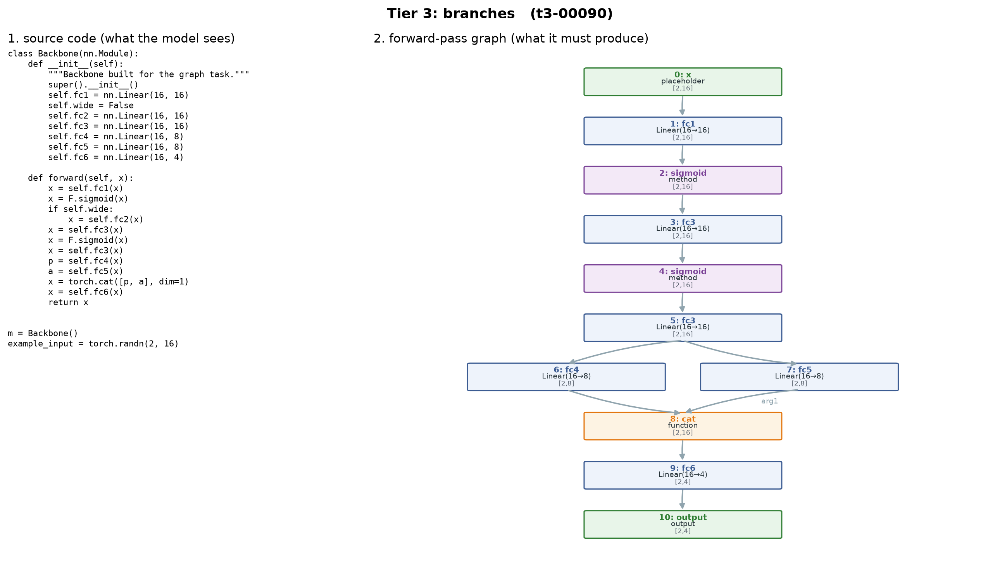

# graphArt_LM

**Can a large model read neural-network code and draw its forward pass as a graph, without running it?**



> **Domain correction (Oct 2026).** This project briefly used Qiskit quantum-circuit DAGs,
> on the reasoning that `circuit_to_dag` supplies exact ground truth for free. The TA
> corrected that after the prep presentation: the allotted statement asks for a *deep
> neural network forward pass* traced from `forward()` and the module class, and
> substituting Qiskit code was not an acceptable reading. PyTorch is the domain. The
> circuit work is retired but intact under `graphart/legacy_qiskit/`, and the harness can
> still score it by repointing `graphart/domain.py` — which is the evidence that the
> framework is genuinely domain-agnostic.

---

## What we are making

**Input:** Python source defining an `nn.Module`.
**Output:** its forward-pass graph, written as text in a fixed format.

```python
class Net(nn.Module):
    def __init__(self):
        super().__init__()
        self.fc1 = nn.Linear(8, 16)
        self.fc2 = nn.Linear(16, 8)
        self.out = nn.Linear(8, 2)

    def forward(self, x):
        h = torch.relu(self.fc1(x))
        h = self.fc2(h) + x          # residual
        return self.out(torch.relu(h))

model = Net()
example_input = torch.randn(1, 8)
```

```
INPUTS 1
NODES
0 placeholder x [1,8]
1 call_module fc1 Linear(in=8,out=16,bias=True) [1,16]
2 call_function relu [1,16]
3 call_module fc2 Linear(in=16,out=8,bias=True) [1,8]
4 call_function add [1,8]
5 call_function relu [1,8]
6 call_module out Linear(in=8,out=2,bias=True) [1,2]
7 output output [1,2]
EDGES
0 -> 1 : arg0
1 -> 2 : arg0
2 -> 3 : arg0
3 -> 4 : arg0
0 -> 4 : arg1          <- the residual: the input feeds the add's second slot
4 -> 5 : arg0
5 -> 6 : arg0
6 -> 7 : arg0
```

Each node is one traced operation. An edge `A -> B` means A's output is an argument of B,
and it names **which argument slots** it fills — because `a - b` and `cat([a, b])` are
order sensitive. If one value fills several slots of the same operation, that is one edge
listing them all (`4 -> 5 : arg0 arg1`).

`torch.fx.symbolic_trace` is PyTorch's own representation of the forward pass, so the
ground truth is exact and free, with nothing labelled by hand.

### Why this is harder than it looks

1. **The code hides the graph.** Loops must be unrolled, `nn.Sequential` and `ModuleList`
   expanded one node per layer, and branches that cannot run dropped entirely.
2. **A layer list is not a graph.** A residual connection runs from an early node to a
   much later one; no ordering of the operations recovers it. The model has to track
   which node each live variable currently refers to.
3. **The output must be exactly right.** One missed layer or edge and the graph is wrong.
   `graphart/validate.py` catches malformed answers without reference to the truth.

---

## Project roadmap

Cheapest to most involved. Every phase is scored by the same harness, so results compare.

### Phase 0: Dataset and evaluation harness ✅ done
Generator for code → graph pairs in 4 tiers, ground truth from `torch.fx`, a structural
validator, metrics, and a renderer.

### Phase 1: Prompting baselines — in progress, first numbers in
Six prompts (see [Prompts](#prompts)), four backends, per-sample reply caching, and a
cost gate that refuses to spend without an explicit `--yes`. Zero-shot is done for two
models; see [Results](#results-so-far). The other five prompts run on a free Kaggle GPU
(`notebooks/kaggle_ollama.ipynb`).

### Phase 2: LoRA fine-tuning a small open model
A 0.5B–1.5B open code model on the training split, on a free Colab or Kaggle GPU.

### Phase 3 (stretch): a tiny transformer from scratch
nanoGPT-scale, to ask whether general pretraining is necessary at all.

### Phase 4: Generalisation
Real architectures from `torchvision`, larger graphs, and held-out code constructs.

### Phase 5: Interface
Paste code, see the predicted graph beside the reference with differences highlighted.

### Research questions
1. How does accuracy fall as the code hides more of the structure (tier 1 → 4)? And as
   the graph grows?
2. Is the hard part *reading the code* or *building the graph*? (The `nodes_only` /
   `edges_only` pair answers this.)
3. Prompting vs fine-tuning vs from scratch: best accuracy for the compute spent?
4. Do models learn the rule, or memorise the generator's habits? (Real `torchvision` code
   is the test.)

---

## Dataset

### Synthetic generator (`graphart/generate.py`)

The tiers vary **how much the code hides the forward pass**, not how big the network is.

| Tier | What the code looks like | Samples | Nodes min/avg/max | Merges |
|---|---|---|---|---|
| 1 flat | one layer per line; reading it is transcription | 400 | 7 / 10.1 / 14 | 0.00 |
| 2 loops | `Sequential`, `ModuleList`, blocks built in a loop | 400 | 8 / 10.4 / 13 | 0.00 |
| 3 branches | residuals, concat splits, dead branches, a reused layer | 400 | 8 / 12.0 / 16 | **2.02** |
| 4 blocks | residual CNN, inception, transformer, U-net | 400 | 12 / 15.1 / 25 | 1.88 |

Tiers 1 and 2 are deliberately pure chains — the difficulty is in reading the code. Tier 3
is where topology appears, and it **manufactures** branching on purpose: measured across
`torchvision`, real architectures sit at an edge-to-node ratio of about 1.1, so found code
does not supply the topology the project is about.

Splits are 80/10/10 within each tier: **1280 train / 160 val / 160 test**. Samples are
deduplicated by graph, so no graph appears in two splits.

### Against house style

A generator that always writes `self.conv1`, always imports the same way and always names
its class `Net` teaches a model its habits rather than the task — and the model then scores
well on a test split that shares those habits and collapses on real code, without us
noticing.

So *what the network is* and *how the code is written* are separated. Tier functions choose
layers and connections; `Style` independently chooses the import form, class name, model
variable, attribute naming scheme, activation idiom, forward-variable convention,
docstrings, comments and bias. Over 320 programs: 14 class names, 5 model variables, 4
import blocks, roughly half functional and half module activations.

### Real code

`torchvision` is the held-out generalisation set. All 15 architectures tested trace
cleanly. The smallest with genuine branching are `squeezenet1_1` (68 nodes, 8 merges) and
`resnet18` (71, 8); `vgg11` and `alexnet` are pure chains and useless as topology tests.
That measurement is what sets the 80-node cap in the dataset builder.

---

## Evaluation (`graphart/validate.py`, `graphart/metrics.py`)

| Metric | Meaning |
|---|---|
| **valid** | Well formed, judged without reference to the answer: acyclic, one output, every node reachable from an input or parameter, operation arities respected, module paths a valid tree, declared shapes mutually consistent |
| **valid_topology** | The same, ignoring shape consistency. This is what gates `exact` |
| **exact** | The same graph as the reference, by labelled isomorphism. The headline number |
| **topo** | `exact`, but comparing nodes without their module parameters and without the function-vs-method distinction (`x.tanh()` vs `torch.tanh(x)`). A model that puts the right operation in the right place but spells it in another notation has still recovered the topology |
| **node F1 / edge F1** | Partial credit on the node and edge multisets |
| **shape_acc** | Of the nodes whose label was right, how many also had the right shape |

Shapes are scored **separately on purpose**. Shape inference is a different skill from
topology, and if a shape were part of the node label then one miscomputed dimension would
drop an otherwise perfect graph to `exact = 0` and the topology result would be lost.

See [docs/validator.md](docs/validator.md) for a plain-language account of what the
validator checks and what it got wrong at first.

---

## Results so far

The same 40 stratified test samples (10 per tier) for every run. Replies are in
`results/*.jsonl`; `python -m pipeline.compare results/*.jsonl --markdown` regenerates the
headline table.

### Zero-shot across model sizes

| model | where | n | parsed | valid | **exact** | topo | t1 | t2 | t3 | t4 |
|---|---|---|---|---|---|---|---|---|---|---|
| Gemma 4 31B (`google/gemma-4-31b-it:free`) | OpenRouter, free tier | 40 | 0.93 | 0.93 | **0.75** | **0.93** | 0.70 | 0.90 | 0.70 | 0.70 |
| Qwen2.5-Coder 14B (`qwen2.5-coder:14b`, Q4) | Ollama, Kaggle 2× T4 | 40 | 0.47 | 0.47 | **0.17** | **0.60** | 0.20 | 0.20 | 0.20 | 0.10 |
| Qwen2.5-Coder 7B (`qwen2.5-coder:7b`, Q4) | Ollama, Kaggle 2× T4 | 40 | 0.80 | 0.55 | **0.20** | **0.25** | 0.30 | 0.50 | 0.00 | 0.00 |
| Qwen2.5-Coder 1.5B (`qwen2.5-coder:1.5b`, Q4) | Ollama, laptop CPU | 40 | 0.62 | 0.42 | **0.00** | **0.05** | 0.00 | 0.00 | 0.00 | 0.00 |

Tier columns are `exact`. The same runs by `topo` per tier, with `few_shot` for the two
mid-size Qwens:

| model | prompt | t1 | t2 | t3 | t4 | **topo** |
|---|---|---|---|---|---|---|
| Qwen 1.5B | zero_shot | 0.20 | 0.00 | 0.00 | 0.00 | **0.05** |
| Qwen 7B | zero_shot | 0.50 | 0.50 | 0.00 | 0.00 | **0.25** |
| Qwen 7B | few_shot | 0.90 | 0.70 | 0.10 | 0.00 | **0.42** |
| Qwen 14B | zero_shot | 1.00 | 0.80 | 0.20 | 0.40 | **0.60** |
| Qwen 14B | few_shot | 1.00 | 0.90 | 0.30 | 0.60 | **0.70** |
| Gemma 31B | zero_shot | 1.00 | 1.00 | 1.00 | 0.70 | **0.93** |

**What it shows so far**
- **Topology appears with scale, chains first (RQ1).** Within one family, zero-shot `topo`
  climbs 0.05 → 0.25 → 0.60 from 1.5B to 7B to 14B. The 7B handles half the pure chains
  (tiers 1–2) but none of tiers 3–4; branching first shows at 14B and is solved by Gemma
  31B. A typical 7B tier-3 error is to turn the dead-branch flag `self.wide = False` into
  graph nodes.
- **Worked examples teach the format, not the topology.** `few_shot` lifts the 7B from 0.25
  to 0.42 and the 14B from 0.60 to 0.70, almost all of it on tiers 1–2; the 7B still gets
  1/20 on tiers 3–4.
- **Gemma 4 31B recovers the topology of everything up to tier 3.** Residuals, concat
  splits, dead branches and a reused layer are all correct (tier 3 `topo` 10/10).
- **Its `exact` misses on tiers 1–3 are all notation**: `x.tanh()` written as a function
  rather than a method. Strict `exact` counts it; `topo` does not.
- **Tier 4 fails on one construct**: `a, q = self.attn(h, h, h)`. torch.fx records the tuple
  unpacking as two `getitem` nodes, including the unused attention weights, and all three
  transformer samples left them out. Every residual CNN, inception and U-net sample was exact.
- **The 1.5B model cannot do the task.** No exact answers; 12 of the 40 replies run away
  (130+ nodes for a 10-node network) until the 1500-token cap cuts them off.

### Qwen2.5-Coder 14B, all six prompts (Kaggle, 2× T4, Q4)

`topo` by tier. It is the fair column here: strict `exact` is dominated by a formatting
slip (below) that hits the prompts very unevenly.

| prompt | t1 | t2 | t3 | t4 | **topo** | exact | parsed |
|---|---|---|---|---|---|---|---|
| `zero_shot` | 1.00 | 0.80 | 0.20 | 0.40 | **0.60** | 0.17 | 0.47 |
| `few_shot` | 1.00 | 0.90 | 0.30 | 0.60 | **0.70** | 0.47 | 0.90 |
| `cot` | 0.90 | 0.80 | 0.10 | 0.30 | **0.53** | 0.15 | 0.55 |
| `cos` | 1.00 | 0.30 | **0.70** | 0.70 | **0.68** | 0.30 | 0.62 |
| `nodes_only` | 1.00 | 0.80 | 0.40 | 0.60 | **0.70** | 0.17 | 0.47 |
| `edges_only` | 1.00 | 1.00 | 0.40 | 0.60 | **0.75** | 0.75 | 1.00 |

For `nodes_only`, `topo` means the node list matches; for `edges_only`, the wiring of the
given nodes matches.

**What it shows** (10 samples per tier, so read single-tier differences of one or two
samples as noise)
- **Decomposition (RQ2): no extra penalty for doing both at once.** Reading the code alone
  (`nodes_only` 0.70) and wiring given nodes alone (`edges_only` 0.75) each fail about a
  quarter of the time; together (`zero_shot` 0.60) is about what two independent ~0.7–0.75
  skills would give (≈0.53). Both skills break on **tier 3** (0.40 each), where dead
  branches and reused layers change the node list and residuals and concats change the
  wiring.
- **Generic step-by-step hurts.** `cot` (0.53) is below `zero_shot` (0.60).
- **Simulation helps where the topology is, and hurts on containers.** `cos` gets 7/10 on
  tier 3, where every other prompt gets 1–4/10, and beats its control `cot` overall (0.68
  vs 0.53). But it gets 3/10 on tier 2, where the others get 8–9/10: walking `forward()`
  statement by statement, the model either keeps a node for the `nn.Sequential` container
  as well as its layers (4 samples), or expands a ModuleList of Sequentials one level only
  (`block1.0` instead of `block1.0.0`, 3 samples). Overall it ties `few_shot` (0.70).
- **The `cos` row is the second run.** The first `cos.txt` lacked the "expand
  `nn.Sequential`" rule the other prompts carry and said "one line per source statement";
  restoring the rule and saying "one line per layer" did not move tier 2 (still 0.30) and
  cost two tier-3 samples (0.90 → 0.70, both operand-slot errors in an `add`). The first
  run is kept in `results/archive/cos-without-sequential-rule/`. Further prompt edits
  should be tuned on the **val** split, not on these 40 test samples.
- **The 14B misreads the format line.** The prompts write a node as
  `<id> <op> <target> [<Class>(<params>)] [<shape>]`, brackets meaning "optional"; in 18/40
  `zero_shot` replies the model wrote a literal `Sigmoid [] [1,16]`. Prompts with worked
  examples (`few_shot`, `cos`) nearly never do. `topo` tolerates it; `exact` does not.

**Two fixes the first reply forced, before anything was counted.** The prompts named the
parameter format for Linear and Conv2d only, so a correct graph failed to parse on
`BatchNorm2d(8)`; all prompts now carry a full label table. And `topo` was added so a
notation slip cannot hide a correct topology. The one pre-fix reply is kept in
`results/archive/pre-label-table/`.

---

## Prompts

| Prompt | What it isolates |
|---|---|
| `zero_shot` | baseline |
| `few_shot` | in-context format learning, 3 worked examples |
| `cot` | generic step-by-step — the control for `cos` |
| `cos` | chain-of-simulation: walk `forward()` statement by statement, recording which node each live variable refers to |
| `nodes_only` | can it read the code and list the operations? |
| `edges_only` | given the operations, can it wire them? |

`nodes_only` and `edges_only` split the task in two. If both halves score well but the
full task does not, the failure is doing them at once — stamina or context — rather than
either skill. All worked examples come from the **train** split only.

---

## Quickstart

```bash
python -m venv .venv
```
```bash
.venv/Scripts/pip install -r requirements.txt
```
```bash
.venv/Scripts/python scripts/build_dataset.py --per-tier 400
```
```bash
.venv/Scripts/python scripts/make_figures.py
```
(On macOS/Linux, use `.venv/bin/` instead of `.venv/Scripts/`.)

### Phase 1: prompting

```bash
.venv/Scripts/pip install -r requirements-pipeline.txt
```

**Spending gate.** Any run that would cost money prints an estimate and refuses unless you
pass `--yes`. Free models, Ollama and the mock backend proceed on their own and still print
`$0.0000`. If a model's price cannot be looked up, the run is treated as paid and blocked.
`--cached-only` rebuilds results from replies already on disk, never constructs a backend,
and so cannot cost anything.

See exactly what would be sent, and what it would cost, without sending anything:
```bash
.venv/Scripts/python -m pipeline.run_prompting --prompt cos --backend mock --dry-run
```

Find model ids and live prices (no key needed):
```bash
.venv/Scripts/python -m pipeline.list_models qwen coder
```

Run, score, and compare:
```bash
.venv/Scripts/python -m pipeline.run_prompting --prompt zero_shot --backend openrouter --model "qwen/qwen-2.5-coder-32b-instruct" --stratify 10 --yes
```
```bash
.venv/Scripts/python -m pipeline.score results/openrouter__qwen-qwen-2.5-coder-32b-instruct__zero_shot.jsonl --slides
```
```bash
.venv/Scripts/python -m pipeline.compare results/*.jsonl --markdown
```

`--stratify 10` takes ten samples per tier — the *same* ten for every model, which is what
makes runs comparable. Replies are cached under `results/raw/`, so a re-run only pays for
what is missing and re-scoring is always free.

**Backends.** `openrouter` needs `OPENROUTER_API_KEY` and reaches every open-weight model
plus GPT and Gemini. `anthropic` needs `ANTHROPIC_API_KEY` from an Anthropic Console
account with credits — a Claude Pro subscription does **not** include API access — and uses
the native SDK rather than a proxy. `ollama` runs locally and costs nothing, but the
reference machine has no discrete GPU, so anything above ~1.5B is impractical there; use a
free Colab GPU for mid-size models.

---

## Repository layout

```
graphArt_LM/
├── graphart/
│   ├── domain.py      # the one place naming the active domain
│   ├── extract.py     # torch.fx trace -> ground-truth graph
│   ├── schema.py      # graph format: dict <-> text, parser for model output
│   ├── validate.py    # structural checks, node and edge labels
│   ├── generate.py    # synthetic nn.Module programs, tiers 1-4
│   ├── metrics.py     # valid / exact / node F1 / edge F1 / shape_acc
│   ├── render.py      # figures, including reference-vs-prediction
│   ├── connect.py     # why the circuit ablation does not port
│   └── legacy_qiskit/ # the retired circuit domain, still runnable
├── pipeline/
│   ├── backends.py    # Anthropic / OpenRouter / Ollama / mock
│   ├── cost.py        # pre-run estimate; paid runs need --yes
│   ├── list_models.py # model ids and live prices, no key needed
│   ├── run_prompting.py
│   ├── score.py
│   └── compare.py     # several runs side by side
├── prompts/           # the six prompts above
├── scripts/           # build_dataset, make_figures, make_slides, make_kaggle_notebook
├── notebooks/         # kaggle_ollama.ipynb -- generated; Phase 1 on a free Kaggle GPU
├── results/           # one .jsonl of replies per (model, prompt) run; raw/ is the git-ignored cache
├── docs/              # validator.md, figures/, presentation/
└── data/generated/    # built by build_dataset.py (git-ignored; seed 0 reproduces it)
```

## Next steps
- [x] Run the zero-shot baseline and record the first numbers.
- [x] `nodes_only` / `edges_only` — the decomposition experiment (Qwen 14B).
- [x] `cot` / `cos` / `few_shot` on the same model (Qwen 14B).
- [x] Mid-size open models on a free Kaggle GPU, to fill the gap above 1.5B (7B, 14B).
- [ ] LoRA fine-tune Qwen2.5-Coder 1.5B on the train split (Phase 2).
- [ ] Rerun the final configurations on all 160 test samples for the write-up.
- [ ] Import `torchvision` as a real-code test set.
- [ ] Rewrite `docs/llm_primer.md` and the slide deck, which still describe the circuit domain.
